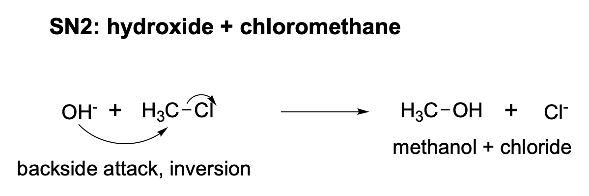
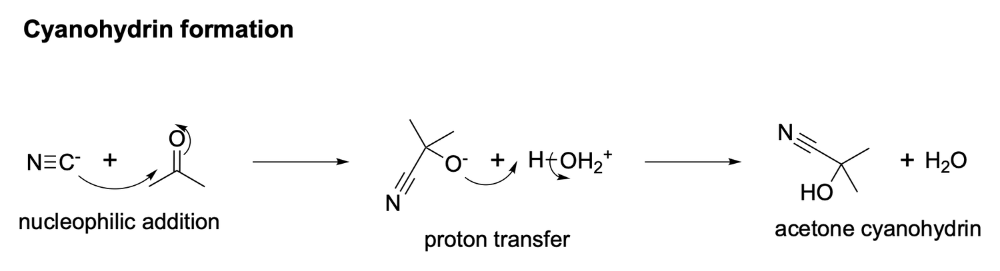
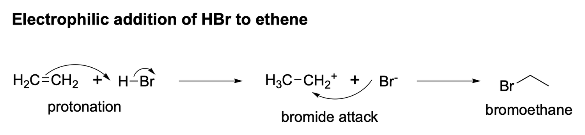
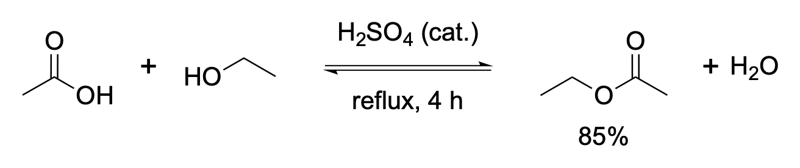
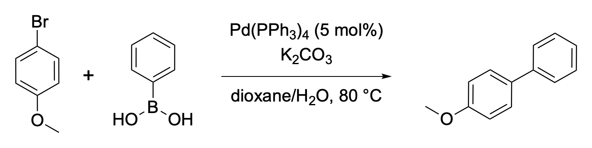
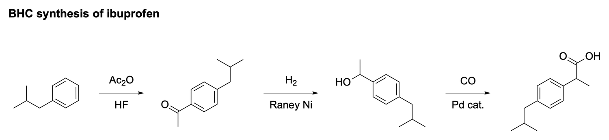
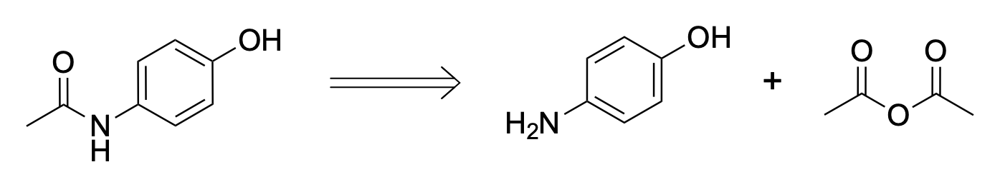
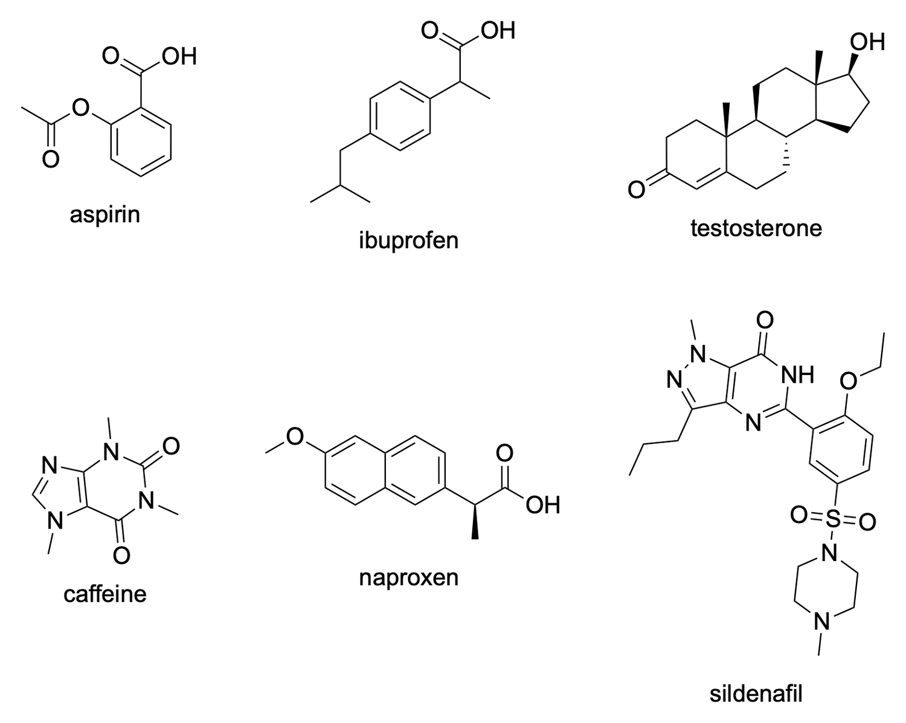
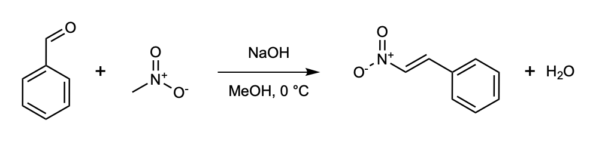
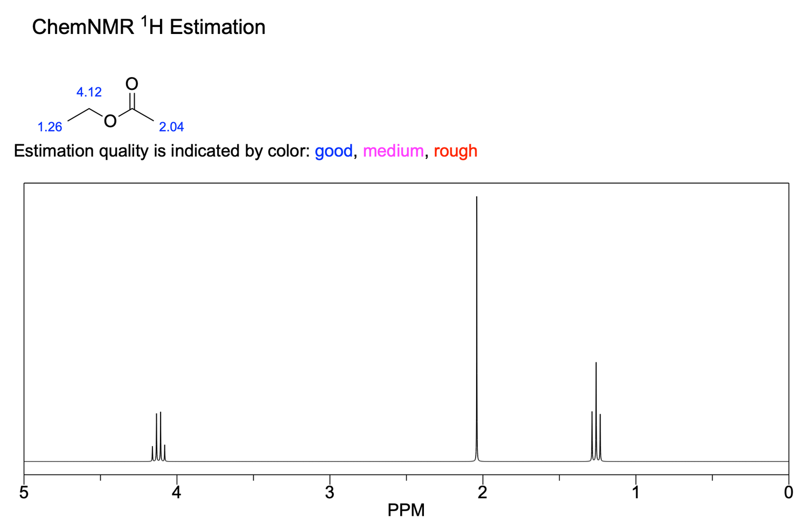

<div align="center">

# chemdraw-mcp

**Let Claude Code, Codex and any MCP client draw in ChemDraw.**

Structures, reactions, multi-step schemes and electron-pushing mechanisms in journal styles, rendered by the real
ChemDraw. Plus names, properties, NMR prediction and format conversion.

[](https://github.com/Jetzu/ChemDraw-MCP/actions/workflows/ci.yml)

-lightgrey)

[](LICENSE)

</div>

```text
> Draw the SN2 mechanism of hydroxide attacking chloromethane with curved arrows.
```

<p align="center"></p>

Every figure in this README was drawn by an agent through this server and exported by ChemDraw 23.
The `.cdxml` source of each one is in [docs/images/cdxml](docs/images/cdxml), so you can open and edit it in ChemDraw.

## Gallery

### Reaction mechanisms

> *"Show the mechanism of cyanohydrin formation from acetone and cyanide, with curved arrows for each step."*

`draw_mechanism` takes stages and electron-pushing arrows (lone pair to new bond, bond to atom, fishhooks) and lays
them out with reaction arrows between the stages.

<p align="center"></p>

> *"Show the electrophilic addition of HBr to ethene step by step with curved arrows."*

<p align="center"></p>

### Reactions

> *"Draw the Fischer esterification of acetic acid with ethanol, H2SO4 (cat.) above the arrow, reflux 4 h below,
> equilibrium arrow, 85% yield under the ester."*

<p align="center"></p>

> *"Suzuki coupling of 4-bromoanisole with phenylboronic acid: predict the product and draw it with the usual conditions."*

100 named-reaction templates (Suzuki, Grignard, Wittig, amide coupling, Diels-Alder, ...) predict the product with RDKit
and draw the reaction with typical reagents and conditions.

<p align="center"></p>

### Multi-step schemes

> *"Lay out the BHC synthesis of ibuprofen from isobutylbenzene as a scheme: Ac2O/HF, then H2/Raney Ni, then CO/Pd."*

<p align="center"></p>

### Retrosynthesis

> *"Show a retrosynthetic disconnection of paracetamol into 4-aminophenol and acetic anhydride."*

<p align="center"></p>

### Structures and names

> *"Draw aspirin, ibuprofen, testosterone, caffeine, naproxen and sildenafil in a 3-column grid and label them."*

Chemical names are resolved offline (a built-in dictionary of about 3,100 reagents, drugs, sugars and natural
products), then by OPSIN and ChemDraw's own Name=Struct.

<p align="center"></p>

### Journal styles

> *"Draw the Henry condensation of benzaldehyde and nitromethane in Nature style."*

Nineteen styles from ChemDraw's stationery: `acs`, `nature`, `rsc`, `wiley`, `science_of_synthesis`, and more.

<p align="center"></p>

### NMR prediction

> *"Predict the 1H NMR spectrum of ethyl acetate."*

<p align="center"></p>

More prompts to copy: [examples/prompts.md](examples/prompts.md) (24 of them, with the tools each one uses).

## What it can do

| | |
|---|---|
| **Draw** | structures, reactions, schemes, retrosyntheses, mechanisms; reagents, conditions, yields, atom mapping |
| **Look** | render to PNG / SVG / PDF / EPS / TIFF with a numerical description, screenshots, read a document back as SMILES |
| **Chemistry** | name to structure and back, formula / MW / logP / TPSA / elemental analysis, reaction balance, 1H / 13C NMR |
| **Convert** | SMILES, InChI, MOL / SDF / RXN (V2000 and V3000), CDXML, CDX, CML, images; read `.cdx` files without ChemDraw |
| **Control** | any of ChemDraw's ~1,600 named commands and menu items, selection, document settings |
| **Headless** | without ChemDraw (Linux, CI) the same tools write CDXML and render with RDKit |

ChemDraw stays in the background: the server never takes your keyboard focus or pops windows to the front.

## Install

```bash
git clone git@github.com:AI-PD-Lab/ChemDraw-MCP.git chemdraw-mcp && cd chemdraw-mcp
python3 install.py
```

This creates a virtual environment, installs the package and registers the `chemdraw` server with Claude Code,
Codex CLI and Claude Desktop (whichever are present). Then ask your agent to draw something.
Check with `python3 install.py --check`; run `/mcp` in Claude Code or `codex mcp list` to see it registered.

Requirements: Python 3.10+ and ChemDraw (developed and tested with ChemDraw 23.1 on macOS). On macOS the first call asks permission
to control ChemDraw and System Events (Automation / Accessibility); grant it to your terminal or IDE.

## Agent Chat inside ChemDraw

A chat panel in ChemDraw itself (**Add-ins > Agent Chat**) that runs your Claude Code or Codex CLI, streams its tool
calls and results, and attaches your current selection to each prompt. Start the bridge from **Scripts > Start Agent
Bridge**, or run `chemdraw-agent-bridge`. `python3 install.py` installs the add-in; restart ChemDraw once.
The bridge listens on `127.0.0.1` only and requires a per-install token. See [docs/agent-chat.md](docs/agent-chat.md).

## Documentation

| | |
|---|---|
| [docs/detailed.md](docs/detailed.md) | full tool table, environment variables, how the engines work, development, limits |
| [docs/tools.md](docs/tools.md) | reference for all 43 tools: parameters, return keys, examples |
| [docs/agent-guide.md](docs/agent-guide.md) | how an agent should sequence the tools |
| [docs/architecture.md](docs/architecture.md) | data flow, CDXML conventions, file locations |
| [docs/agent-chat.md](docs/agent-chat.md) | the in-app chat panel and its bridge |
| [docs/windows.md](docs/windows.md) | the Windows COM backend |
| [examples/](examples) | runnable scripts, prompts, and `make_gallery.py` which regenerates the images above |

Windows support is experimental: the COM backend was written from the published object model and has not been run
against a real ChemDraw on Windows yet. macOS is the tested platform.

Licensed under the [PolyForm Noncommercial License 1.0.0](LICENSE): free for noncommercial use, commercial use needs a separate licence from the author. ChemDraw is a trademark of Revvity Signals Software, Inc.; this project is not affiliated with it.
